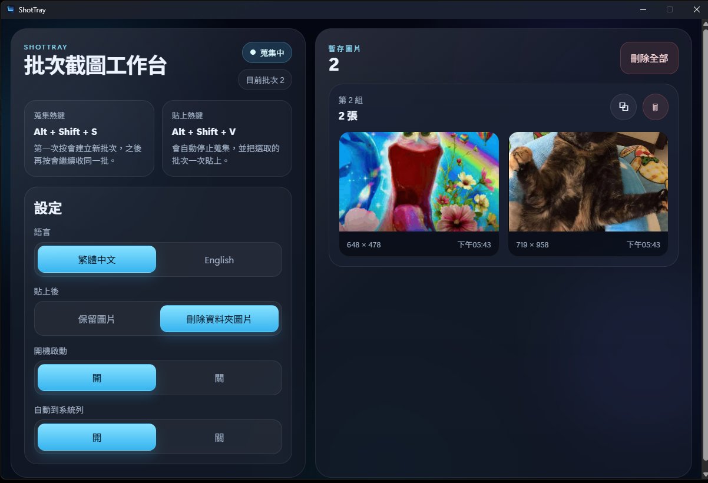

# ShotTray

ShotTray 是一個 Windows 桌面工具，用來連續蒐集多張截圖，並在需要時一次貼到其他 App。

適合需要把多張錯誤畫面、操作步驟、聊天截圖或資料截圖一次丟給 AI、客服、文件、Issue 或聊天工具的人。

## 介面預覽



## 下載

到 GitHub Releases 下載最新版：

https://github.com/ChuangHoward902/shottray/releases

下載最新版的 `ShotTray-版本號-win.exe` 後直接執行即可。

更新到新版：先在系統列圖示按右鍵「結束程式」，再執行新版的 exe，設定會保留。

## 使用前須知

ShotTray 是從 Windows 截圖工具自動存檔的資料夾收圖：`圖片\螢幕擷取畫面`（英文系統是 `Pictures\Screenshots`）。

- Windows 11 的「剪取工具」預設會自動存檔，不用另外設定。
- 如果收不到圖，請打開「剪取工具」的設定，確認「自動儲存螢幕擷取畫面」（Automatically save original screenshots）是開的。
- 只有按下 `Alt + Shift + S` 開始蒐集之後才存進資料夾的截圖，才會被收進這一批；之前就在資料夾裡的圖不會被收進來。

## 功能

- 用 `Alt + Shift + S` 開始或繼續蒐集截圖
- 用 `Alt + Shift + V` 停止蒐集，並把目前批次照拍的順序一次貼上
- 每次開始到貼上之間的截圖會自動分成一組
- 可以選擇保留截圖，或貼上後把這一批截圖移到資源回收筒
- 貼上後剪貼簿會換回原本的內容
- 快捷鍵被其他程式占用時，視窗上會提示
- 支援繁體中文與 English
- 支援開機啟動
- 支援最小化到系統列
- 系統列右鍵可開始或停止蒐集

## 快捷鍵

| 快捷鍵 | 功能 |
| --- | --- |
| `Alt + Shift + S` | 開啟 Windows 截圖流程並開始蒐集 |
| `Alt + Shift + V` | 停止蒐集並貼上選取批次或目前批次 |

## 使用方式

1. 執行 ShotTray
2. 按 `Alt + Shift + S` 截圖
3. 需要多張時，繼續按 `Alt + Shift + S`
4. 回到要貼上的 App
5. 按 `Alt + Shift + V` 一次貼上目前批次（先拍的先貼）

視窗裡的「刪除全部」、「刪除整組」只會清掉 ShotTray 的暫存清單，不會刪除資料夾裡的截圖檔。

## 開發

```bash
npm install
npm run dev
```

在 Windows 上也可以直接執行 `run-dev.bat`。

## 測試

```bash
npm run typecheck
npm test
```

`npm test` 會先編譯，再用模擬的 Electron 和截圖資料夾測試蒐集、貼上順序、刪除與剪貼簿等行為，不需要 Windows。

## 打包

```bash
npm run dist
```

打包後的 exe 會輸出到 `release/ShotTray-版本號-win.exe`。

### 讓 GitHub 打包

每次推送到 `main`，GitHub 會自動在 Windows 上打包。到專案的 `Actions` 頁面，打開最新一次 `Build Windows app`，在最下面的 `Artifacts` 下載 `ShotTray-win`（是 zip，解壓縮後就是 exe）。也可以按 `Run workflow` 手動重跑。

### 發布新版

1. 改 `package.json` 的版本號，並在 `CHANGELOG.md` 加上同版本號的段落（例如 `## 0.1.3`，Release 的說明會取自這裡）。
2. 推到 `main`，等打包完成，下載 exe 先測試。
3. 測試沒問題後，到 `Actions` → `Build Windows app` → `Run workflow`，勾選 `release` 再執行。GitHub 會重新打包，用這個版本號發布 Release 並附上 exe。已經發布過的版本號不會被覆蓋，會直接失敗。

## 技術

- Electron
- TypeScript
- electron-vite
- electron-builder
- Windows 內建截圖流程

## 授權

MIT License
